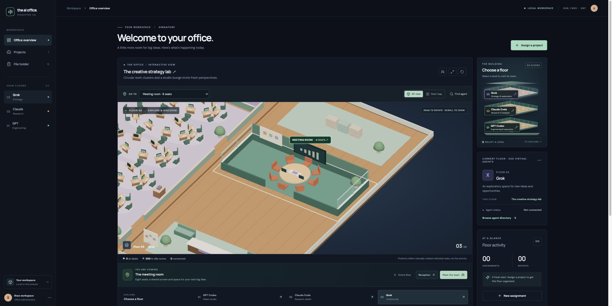

# The AI Office



A local, interactive three-floor office dashboard for a Mac. The clickable stacked-building view opens floor 1 (GPT Codex maker studio), floor 2 (Claude Code research atelier), or floor 3 (Grok creative strategy lab). Each floor has its own layout and shared spaces. Each large floor has 200 virtual team members across four departments. Each department has a designated idle room and 50 workstations arranged in modern paired desk pods, with chairs, screens, and circulation aisles. Drag to rotate, right-drag to pan, scroll to zoom, and click a figure to inspect it. Use the directory button to search by number or department; use the expand button for a larger view.

## Start the office

```bash
npm install
npm run dev
```

Open the local address printed in Terminal (normally http://127.0.0.1:5173). Keep Terminal open while using the app. To create a production build, run `npm run build`.

On your Mac, after installing dependencies, you can also double-click `Start AI Office.command` to start the office and open it in your browser.

## What works today

- Explore three large interactive 3D floors with 200 animated, clickable virtual team members per floor. Search the directory to find a specific figure.
- Use **Go to** or click a room label to zoom into a department, idle room, meeting room, reception, or reports hub. Switch between **3D view** and the top-down **Seat map**, and return with **Entire floor**. Camera transitions respect reduced-motion preferences.
- Filter the directory by **At desks** or **Idle rooms**. Open a person and choose **Locate in office** to find their exact position, marked with a ring and name label. Their profile remains available from **View agent**.
- Explore four spacious, labelled departments per floor, plus reception, an enclosed eight-seat meeting room, and a reports and progress area. Select the 3D report or progress signs to open those views.
- Meeting rooms include glass partitions, a shared display, whiteboard, laptops and an eight-seat table. Navigation and agent dialogs also work in fullscreen; use **Exit fullscreen** to return.
- Save project names, GitHub links or local paths, work briefs, and floor-wide or individual assignments. Set progress manually to Planned, In progress, Blocked, or Done.
- Save manual reports in the file holder, optionally linked to a project and individual agent. An individual's detail panel shows their linked work and notes. Assignments and reports are stored in this browser's local storage on this Mac.

Characters are simulated, stylized 3D representations. A person appears at a desk when at least one individual assignment is manually marked In progress; otherwise the person stays in their department’s idle room. Floor-wide assignments do not change individual positions. These positions do not indicate live agent activity. Agent connections, execution, GitHub access, and automatic activity or reports are **not connected**. Saving an assignment does not send a task to an agent. Browser data can be cleared by the browser, so keep separate copies of important information.
